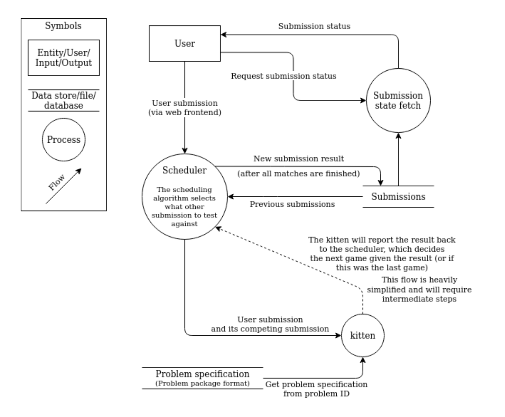

# DD1349 Project in Introduction to Computer Science

An important aspect of working on an actual project is that not all work is to write code, this is something you're all going to learn with this course (god forbid you learn this the hard way in MDI or MVK) and should be your focus.

_Issue_: Your professional life will be too much of meetings, slide decks, documentation, and planning.

Sometimes projects don't turn out as expected. The least you can do is to lay out your expectations. Everyone should be reaching for the same goal with somwhat aligned prioritations.

## Assignment

### Recommended Steps

Keep on reading to find more detailed descriptions of some of these steps!

1. Find or create a group of 2-4 students
2. Decide what you want to do.
3. Write a specification
   * Do this now or after step `7.`
4. Create a github repo under `INDAPlus25` named: `<kth-id-1>-...<kth-id-n>-project`
5. Create a "project" in the github repo. Or create a Trello.
6. Create Github milestones.
7. Compile a board/table of _must-haves_, _nice-to-have_ and _risks_.
   - Seperate your project MVP requirements from the "dream" senario.
   - Admit the obvious risks and bottle necks.
   - Add your findings to your milestones. 
8. Define initial issues and distribute the initial workloads.
9. Iterativly work on your SRC, project specification, issues, and project architecture specification.

### Github Project or Trello
These services are _very_ similar. They allow you to create different boards where you can organize cards. Imagine having a digital bulletin board which can be linked to issues!

For example, you could have カンバン boards with sections:
   * Icebox
   * Backlog
   * In progress
   * Bottle-necked
   * Complete

### Milestones
Github has a feature called Milestones, found under `issues`. 

Whenever you create an issue on github you can connect it to a Milestone. It's just a glorified way of grouping issues together.

You can use this feature to determine what should be done on a weekly basis, or to scope the project.

Example milestones: 
      1. MVP: Smallest possible deliverable.
      2. Goal: Your actual goal with this project.
      3. Vision: The actual dream idea you started with.

### Specification
Writing project specs is a good practice to follow, however, thats not only why you do them now.

The report should be in `.md` or `.pdf` format (LaTeX anyone?) and placed in your repo. It should contain the following:

* Any links to the repo (yes, recursion) or Trello if that is used
* Your specification should specify what naming convencion you will use for both:
    * Issues & Commits
      * Issues (and commit messages) are (by github standard) in future tense, i.e `"Fix this bug"` not `"Fixed this bug"` and can be named however you like, as long as they describe the issue itself. Recommended is short titles with a more elaborate description.
    * PR's
      * Pull Requests should be named after an associated issue. Given an issue `#13, "Improve performance"`, I would create the branch using `$ git switch -c issue/13-improve-performance`. It is up to your group if you wish to follow this our use a different convention.
* Most importantly, tell us what you are going to create in your project. You should include a short part about how feasible your project is and how it can be divided into weeks.
* Who is going to do what?

#### Deside on a Git Methodology
Two common ones are _Git Flow_ and _Trunk-based Development_.

### Architecture

Most often a developer team will produce a clear overview of the architecture of the system at hand. This arcitecture can be a UML graphic or simular. All the way from high level, to low level class diagrams.

Example:

#### Platform Architecture
Frameworks, platforms, and languages often come with their own standard file structures (SRC architectures) of a project. However, these are mere suggestions.

Example: If you are writing a web server application, I recommend _hexagonal architecture_.

**I strongly suggest you to write specification on the file structure and architecture of your project.**

## Project Criteria
You are required to achieve the following by the end of the course.

### Pace
You need to progress every week! Do not grind it out the last week.

### Project Level
Your project should be advanced enough to pass!

Pong is too simple.

Tetris is good enough for 2 people, not 3 or 4.

The rest explains itself. Motivate why your project is advanced enough!

### Use the Issue tracker!
For every feature you want to create (or bug to fix), there should be an associated issue, hopefully the next few paragraphs will explain why.

  * Follow your naming convention. Assign assignees and attach labels, it looks cool! 
    * **Do not** forget to add issues to milestones, this can be done under the menu for each issue. 
  * Read on about branches to know how to close an issue the good way!

#### Connect to milestones and PR's
To provide structure for your projects, it is good practice to use this feature (described above).

### Use Branches and Pull Requests
There is no such thing as working together properly on github without using branches. Therefore we require you to master the following:

* Follow your naming convention and workflow methodology as defined in your project specification.
* Merge feature branches only by creating pull requests.
  * Include a description of your feature.
  * Let another group member peer review your code.
  * Make suggestions and amendments.
  * Then, merge.

Using branches is important when working together but it also has some other features:
* Use branches to close issues.
  * Before merging a branch, add (for example) `Fix #13` to the description of the Pull Request. Github will automatically read the word `(Ff)ix` and the number of an issue and close it!
  * You can also just write `#13` to _mention_ an issue without closing it. This will create a link between different pages on github.
  * All of the above can also be done in commit messages, but are not as important.

* If you are really picky, you can _lock_ your repo to only allow merging into master using PR's.
  * You can also make it so only a user _other_ than the one who created the PR can merge it.